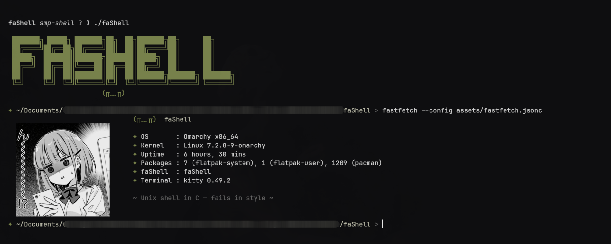

# faShell


*a Unix shell in C - fails in style.*

faShell **فشل** ("failure" in Arabic) - because writing a shell for homework is
the closest a student comes to being a kernel developer, and failing at it is the
easiest step to TAKE.

---

## ✦ What it does

| Feature | Joke |
|---|---|
| `ls`, `cat`, `chmod` - the whole world of `execvp` | Runs commands. Only the commands themselves can fail. |
| `cd` | Changes directories *without* failing, which for this shell counts as a personality. |
| `cmd > out.txt` / `cmd < in.txt` | Redirects pipes and files - the tax you pay at files. |
| `cmd1 \| cmd2 \| cmd3 \| ...` | Pipes of unreal N-length, one wasted pipe end at a time. |
| `cmd &` | Runs in the background, so a mistake gets reaped... eventually. |
| `!!` | Runs the last command *again*, because the first failure wasn't enough. |
| `history` | Inventory of everything you've ever mistyped, in order. |
| `Terminal` | Prompt colors: Miasma olive. Errors: bold. Meaning: not Ma's. |
| Ctrl+C | Gives up. Gives up *bash-smooth*. |
| Ctrl+D | Exits (some things fail gracefully). |


## ✦ Build & Run

```bash
make
./faShell
```
That's it. If it doesn't build, the shell also failed.

## ✦ Example session

```bash
~/os/faShell > echo "write a shell" | tee attempt1.c
~/os/faShell > gcc attempt1.c -o faShell

恭喜，你的 `attempt1.c` - 398 lines of segfaults and dreams.
~/os/faShell > ./faShell
✦ faShell banner shows ~ once ~ because on stdout, the dead don't function 〜
```

## ✦ Why "faShell"?

The first version failed to run `ls`. The second failed to run `cd`.
The third hung on a pipe and its author learned what "deadlock" means for real.
"faShell" is the only name that has *stayed true* throughout the whole project.

## ✦ Fine print

- If the banner shows up, you're on a tty. In pipes, the banner stays home because
  graders don't send emoticons.
- Zombies get reaped at the next prompt. This shell may not succeed, but its
  children are never unclaimed.

